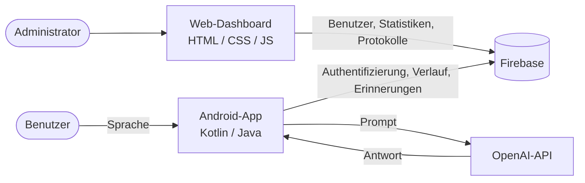
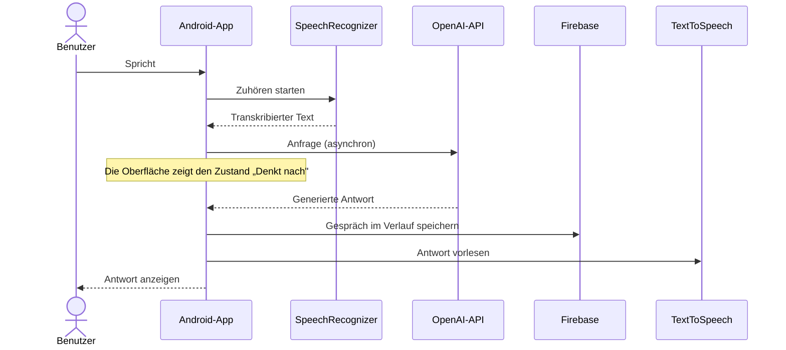
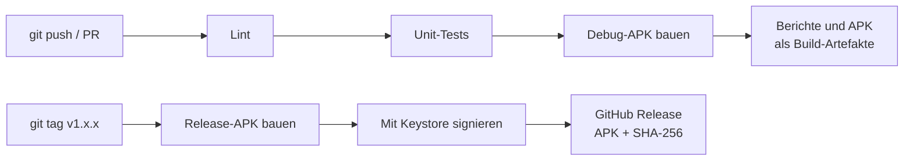

<div align="center">

# Alexandra — KI-Sprachassistent   

**Ein nativer Android-Sprachassistent, der zuhört, mit der OpenAI-API nachdenkt und laut antwortet — ergänzt durch ein Web-Dashboard zur Benutzerverwaltung.**

Abschlussprojekt (PFE) · 2026

[**🎥 Video-Demo**](https://github.com/El-Tousy/alexandra-voice-assistant/tree/main/Video%20Demo) · [**📸 Screenshots**](#screenshots) · [**🏗️ Architektur**](#architektur)

[](LICENSE)


[🇬🇧 English](README.en.md) · [🇩🇪 Deutsch](README.md)

</div>

<p align="center">
  
</p>

---

## Inhaltsverzeichnis

- [Überblick](#überblick)
- [Was dieses Projekt zeigt](#was-dieses-projekt-zeigt)
- [Funktionen](#funktionen)
- [Screenshots](#screenshots)
- [Architektur](#architektur)
- [Tech-Stack](#tech-stack)
- [Erste Schritte](#erste-schritte)
- [Konfiguration](#konfiguration)
- [Tests](#tests)
- [Projektstruktur](#projektstruktur)
- [Sicherheit](#sicherheit)
- [Technische Herausforderungen und Erkenntnisse](#technische-herausforderungen-und-erkenntnisse)
- [Roadmap](#roadmap)
- [Autor](#autor)
- [Lizenz](#lizenz)

---

## Überblick

Alexandra ist ein Sprachassistent von Anfang bis Ende. Ein Benutzer spricht mit der Android-App, die Sprache wird auf dem Gerät transkribiert, der Text wird an die OpenAI-API gesendet, und die Antwort wird angezeigt und laut vorgelesen. Konversationen werden pro Benutzer gespeichert, sodass sie später nachgelesen werden können.

Das Projekt deckt den gesamten Stack ab und nicht nur eine einzelne Schicht:

| Komponente | Rolle |
|---|---|
| **Android-App** (Kotlin / Java) | Spracherfassung, Konversationsoberfläche, Erinnerungen, Benachrichtigungen, Benutzerprofil |
| **Firebase** | Benutzerauthentifizierung und Datenspeicherung |
| **OpenAI-API** | Konversationelle Intelligenz |
| **Web-Dashboard** (HTML / CSS / JS) | Benutzerverwaltung und Nutzungsübersicht für Administratoren |
| **GitHub Actions** | Automatisiertes Linting, Testen, Bauen und signierte APK-Releases |

---

## Was dieses Projekt zeigt

Für alle, die dieses Repository ansehen, zeigt es in der Praxis Folgendes:

- **Native Android-Entwicklung** mit Kotlin und Java, einschließlich Laufzeitberechtigungen, Spracherkennung und Text-to-Speech
- **Integration von Drittanbieter-APIs** mit asynchronen Aufrufen, die den UI-Thread nie blockieren
- **Authentifizierung und Persistenz** mit Firebase
- **Full-Stack-Umfang**: ein mobiler Client *und* eine Web-Oberfläche zur Administration
- **Ingenieurmäßige Sorgfalt**: CI bei jedem Push, signierte und versionierte Releases, Abhängigkeits-Updates über Dependabot, Geheimnisse außerhalb der Versionskontrolle
- **Ehrliche technische Einschätzung**: Bekannte Einschränkungen und Kompromisse sind unter [Sicherheit](#sicherheit) und [Roadmap](#roadmap) dokumentiert und werden nicht verschwiegen

---

## Funktionen

### Mobile Anwendung

- **Spracherkennung** — freihändige Interaktion mit dem `SpeechRecognizer` von Android
- **KI-Konversation** — Antworten, die über die OpenAI-API generiert werden
- **Gesprochene Antworten** — Antworten werden mit dem Text-to-Speech von Android vorgelesen
- **Konversationsverlauf** — frühere Gespräche werden pro Benutzer gespeichert
- **Erinnerungen und Aufgaben** — Erinnerungen per Sprache erstellen und verwalten
- **Intelligente Benachrichtigungen** — Hinweise zum richtigen Zeitpunkt
- **Authentifizierung** — Registrierung, Anmeldung und ein Profilbildschirm
- **Berechtigungsablauf** — ein eigener Bildschirm, der den Zugriff auf das Mikrofon erklärt und anfordert

### Web-Dashboard

- **Benutzerverwaltung** — Benutzer hinzufügen, bearbeiten und löschen
- **Statistiken** — Übersicht über die App-Nutzung
- **Sichere Anmeldung** — geschützter Administratorzugang
- **Aktivitätsprotokoll** — Nachvollziehbarkeit der Benutzeraktionen

---

## Screenshots

### Mobile Anwendung

<table>
  <tr>
    <td align="center"><br /><sub>Startseite</sub></td>
    <td align="center"><br /><sub>Verlauf</sub></td>
    <td align="center"><br /><sub>Profil</sub></td>
  </tr>
  <tr>
    <td align="center"><br /><sub>Anmeldung</sub></td>
    <td align="center"><br /><sub>Registrierung</sub></td>
    <td align="center"><br /><sub>Berechtigungen</sub></td>
  </tr>
</table>

### Web-Dashboard

| Admin | Benutzer | Anmeldung |
|---|---|---|
|  |  |  |

---

## Architektur

### Systemübersicht



### Ablauf der Sprachinteraktion



### Auslieferungs-Pipeline



---

## Tech-Stack

| Schicht | Technologie | Zweck |
|---|---|---|
| Mobil | Kotlin, Java | Hauptanwendung; Java für Legacy-Module beibehalten |
| Sprache | Android `SpeechRecognizer`, `TextToSpeech` | Sprache-zu-Text und Text-zu-Sprache auf dem Gerät |
| KI | OpenAI-API | Konversationelle Antworten |
| Backend | Firebase Authentication, Firebase-Datenbank | Benutzer, Sitzungen, Verlauf |
| Dashboard | HTML, CSS, JavaScript | Administrationsoberfläche |
| Build | Gradle (Kotlin DSL) | Build- und Abhängigkeitsverwaltung |
| CI/CD | GitHub Actions, Dependabot | Automatisierte Prüfungen, Releases, Abhängigkeits-Updates |

---

## Erste Schritte

### Voraussetzungen

- **Android Studio** — aktuelle stabile Version
- **JDK 17**
- Ein **Firebase**-Projekt (der kostenlose Spark-Tarif genügt)
- Ein **OpenAI-API-Schlüssel**

### 1. Repository klonen

```bash
git clone https://github.com/El-Tousy/alexandra-voice-assistant.git
cd alexandra-voice-assistant
```

### 2. Firebase konfigurieren

1. Erstelle ein Projekt in der [Firebase-Konsole](https://console.firebase.google.com/).
2. Füge eine Android-App mit dem Paketnamen hinzu, der in `android_studio_codes/app/build.gradle.kts` (`applicationId`) steht.
4. Lade `google-services.json` herunter und lege sie hier ab:

   ```
   android_studio_codes/app/google-services.json
   ```

   Diese Datei wird von Git ignoriert und darf niemals committet werden.

### 3. Eigenen OpenAI-Schlüssel hinzufügen

Füge den Schlüssel in `android_studio_codes/local.properties` ein (ebenfalls von Git ignoriert):

```properties
OPENAI_API_KEY=sk-your-key-here
```


### 4. App ausführen

Öffne `android_studio_codes/` in Android Studio, lasse Gradle synchronisieren und drücke dann auf **Run**. Oder über die Kommandozeile:

```bash
cd android_studio_codes
./gradlew installDebug
```

Beim ersten Start fragt die App nach der Mikrofonberechtigung.

### 5. Dashboard ausführen (optional)

Das Dashboard ist statisch. Vom Stammverzeichnis des Repositorys aus:

```bash
npx serve dashboard_pages
```

Öffne anschließend `http://localhost:3000/login.html`.
### Ausprobieren ohne Build

Lade die neueste signierte APK von der [Releases-Seite](https://github.com/El-Tousy/alexandra-voice-assistant/releases/latest) herunter und überprüfe ihre Integrität:

```bash
sha256sum -c alexandra-vX.Y.Z.apk.sha256
```

---

## Konfiguration

In diesem Repository wird nichts Sensibles gespeichert.

| Element | Zweck | Ort | Committet |
|---|---|---|---|
| `google-services.json` | Firebase-Projektkonfiguration | `android_studio_codes/app/` | Nein |
| `OPENAI_API_KEY` | OpenAI-Authentifizierung | `android_studio_codes/local.properties` | Nein |
| Release-Keystore | Signiert die Release-APK | GitHub-Actions-Secret | Nein |

---

### Ein Release veröffentlichen

```bash
git tag v1.0.0
git push origin v1.0.0
```

<details>
<summary><b>Einmalige Einrichtung: Signatur-Secrets</b></summary>

Erzeuge einen Keystore (bewahre ihn außerhalb des Repositorys auf und sichere ihn — geht er verloren, kannst du die App nie wieder mit derselben Signatur aktualisieren):

```bash
keytool -genkeypair -v -keystore release.keystore -alias alexandra \
  -keyalg RSA -keysize 2048 -validity 10000
```

Kodiere ihn und füge vier Secrets unter **Settings → Secrets and variables → Actions** hinzu:

```bash
base64 -w0 release.keystore
```

| Secret | Wert |
|---|---|
| `KEYSTORE_BASE64` | Ausgabe des obigen Befehls |
| `KEYSTORE_PASSWORD` | Keystore-Passwort |
| `KEY_ALIAS` | `alexandra` |
| `KEY_PASSWORD` | Schlüsselpasswort |

</details>

---

## Tests

```bash
cd android_studio_codes
./gradlew testDebugUnitTest   # Unit-Tests
./gradlew lintDebug           # Statische Analyse
```
Beide Befehle laufen bei jedem Push und jedem Pull Request automatisch.

---

## Projektstruktur

```
alexandra-voice-assistant/
│
├── android_studio_codes/        # Android-Projekt
│   ├── app/
│   │   └── src/main/
│   │       ├── java/            # Kotlin- und Java-Quellcode
│   │       ├── res/             # Layouts, Drawables, Farben, Menüs, Werte
│   │       └── AndroidManifest.xml
│   ├── build.gradle.kts
│   └── settings.gradle.kts
│
├── dashboard_pages/             # Web-Oberfläche zur Administration
│   ├── dashboard-admin.html
│   ├── dashboard-user.html
│   └── login.html
│
├── docs/                        # Demo-GIF 
├── screenshots/
│   ├── app/
│   └── dashboard/
│
├── LICENSE
└── README.md
```

---

## Sicherheit

- **Geheimnisse bleiben aus Git heraus.** Der OpenAI-Schlüssel und `google-services.json` sind vom Repository ausgeschlossen und werden lokal oder über CI-Secrets bereitgestellt.
- **Signierte, überprüfbare Releases.** Release-APKs werden mit einem privaten Keystore signiert, der als verschlüsseltes GitHub-Secret gespeichert ist, und mit einer SHA-256-Prüfsumme veröffentlicht.
- **Minimale Rechte in der CI.** Workflows fordern nur die Berechtigungen an, die sie benötigen.

### Bekannte Einschränkung: Der OpenAI-Schlüssel liegt im Client

Ein in eine Android-App eingebetteter Schlüssel kann von jedem extrahiert werden, der die APK entpackt. Für die lokale Entwicklung ist das akzeptabel, für einen öffentlichen Build jedoch **nicht**: Öffentlich verteilte APKs werden deshalb **ohne** echten Schlüssel gebaut.

Das Design für den Produktivbetrieb sieht vor, den Schlüssel auf einem Server zu halten und die App stattdessen diesen Server aufrufen zu lassen. Das steht auf der [Roadmap](#roadmap): eine Firebase Cloud Function als authentifizierter Proxy, sodass der Schlüssel das Backend nie verlässt und Anfragen pro Benutzer begrenzt werden können.

---

## Technische Herausforderungen und Erkenntnisse

- **Echtzeit-Koordination.** Die kontinuierliche Spracherkennung musste neben den Netzwerkaufrufen an die OpenAI-API laufen, ohne jemals den UI-Thread zu blockieren. Dafür war eine klare Trennung zwischen Zuhör-, Warte- und Sprechzustand nötig.

- **API-Latenz.** Ein Aufruf an ein Sprachmodell dauert Sekunden. Ohne Rückmeldung nehmen Benutzer an, dass die App eingefroren ist, weshalb die Oberfläche bis zum Eintreffen der Antwort einen ausdrücklichen Zustand „Denkt nach" anzeigt.

- **Zwei Sprachen in einer Codebasis.** Kotlin und Java koexistieren, mit Legacy-Modulen neben neuerem Code. Die Interoperabilität sauber zu halten (Nullability, Callbacks, Coroutines gegenüber Threads) war eine praktische Lektion in schrittweiser Migration.

- **Verwaltung von Geheimnissen.** Den OpenAI-Schlüssel und die Firebase-Konfiguration aus dem Repository herauszuhalten, hat sowohl die lokale Einrichtung als auch das CI-Design geprägt — und dazu geführt, die oben beschriebene Einschränkung des clientseitigen Schlüssels zu erkennen.

- **Automatisierung der Auslieferung.** Die CI/CD-Pipeline aufzubauen bedeutete, den Build ohne Geheimnisse reproduzierbar zu machen und herauszufinden, wie man eine APK sicher von einem CI-Runner aus signiert.

---

## Roadmap

- [x] Spracherkennung und KI-Konversation
- [x] Firebase-Authentifizierung und Verlauf
- [x] Web-Dashboard zur Administration
- [x] CI: Lint, Test, Build bei jedem Push
- [x] Signierte APK-Releases bei Versions-Tags
- [ ] OpenAI-Aufrufe hinter eine Firebase Cloud Function verlagern
- [ ] Unit-Tests für die Konversations- und Erinnerungslogik
- [ ] Das Dashboard bereitstellen (Firebase Hosting oder GitHub Pages) mit Live-Link
- [ ] Migration der Legacy-Java-Module zu Kotlin abschließen
- [ ] Mehrsprachige Sprachunterstützung (Arabisch, Französisch, Englisch)
- [ ] Offline-Behandlung und Fehlerwiederherstellung bei Netzwerkausfall

---

## Autor

**El_Tousy** — Informatikstudentin

[](https://github.com/El-Tousy)
[](mailto:leilaeltousy@gmail.com)

---

## Lizenz

Verbreitet unter der MIT-Lizenz. Siehe [LICENSE](LICENSE) für Details.

---

<div align="center">

⭐ Wenn dir dieses Projekt nützlich erscheint, hinterlasse gerne einen Stern.

</div>
